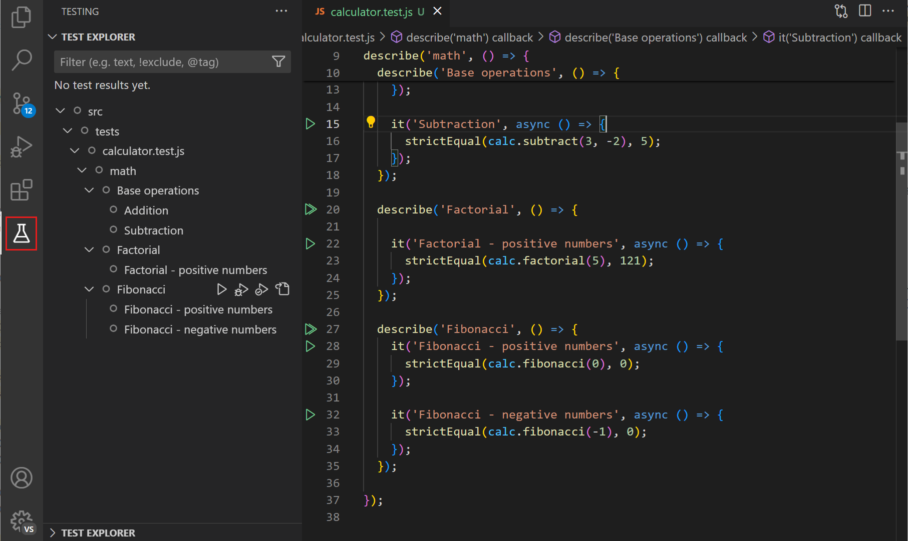
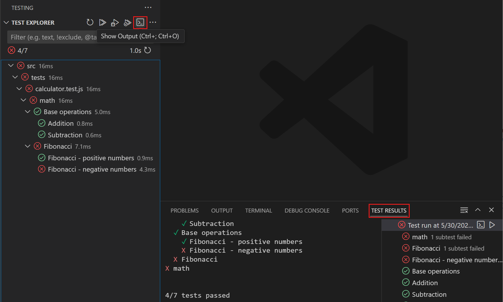
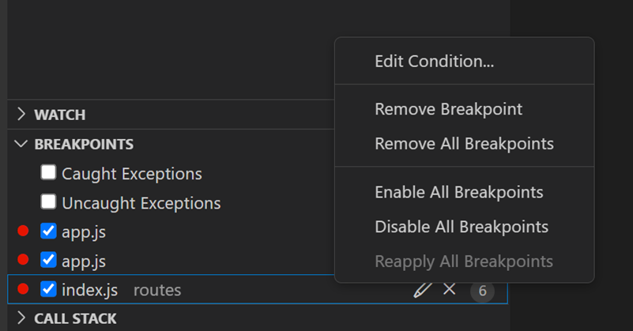
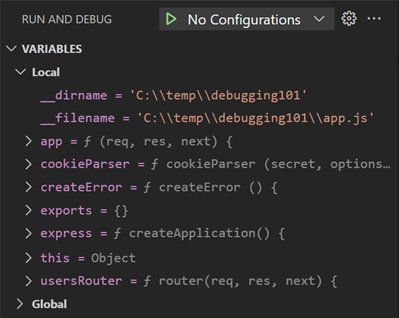
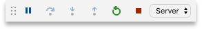
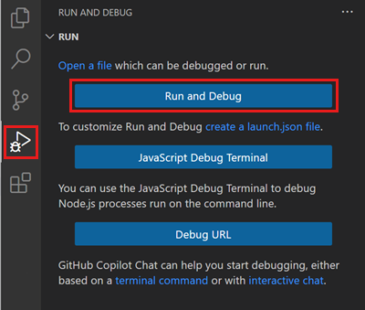

# Poradnik pary: jak uruchamiać i gdzie patrzeć

Nie musicie umieć debugować – ten poradnik pokazuje krok po kroku, gdzie zobaczyć zmiany,
jak podejrzeć dane i co zrobić, gdy coś nie działa. Wszystko robicie w VS Code i przeglądarce Edge.
Zaglądajcie tu, jeśli potrzebujecie pomocy z uruchomieniem aplikacji lub narzędziami.

## Spis treści

1. [Terminal w VS Code](#1-terminal-w-vs-code)
2. [Uruchamianie aplikacji (F5 albo dotnet run)](#2-uruchamianie-aplikacji)
3. [Zatrzymywanie aplikacji](#3-zatrzymywanie-aplikacji)
4. [Testy: ikona kolby i dotnet test](#4-testy)
5. [Czerwony test – co teraz?](#5-czerwony-test--co-teraz)
6. [Narzędzia deweloperskie Edge (F12)](#6-narzędzia-deweloperskie-edge-f12)
7. [Debuger VS Code: pułapka w kodzie](#7-debuger-vs-code-pułapka-w-kodzie)
8. [Baza danych w rozszerzeniu SQLite Viewer](#8-baza-danych-w-rozszerzeniu-sqlite-viewer)
9. [Mapa repozytorium: gdzie co leży](#9-mapa-repozytorium)

## 1. Terminal w VS Code

Terminal to okno, w którym wpisuje się polecenia. Otworzecie go klawiszami **Ctrl + `**
(odwrotny apostrof, pod Esc) albo menu *View → Terminal*. Wklejanie: **Ctrl + Shift + V**
albo prawy przycisk myszy.

Polecenia, których używacie na warsztacie (każde zatwierdzacie Enterem):

```text
powershell -ExecutionPolicy Bypass -File tools/nowy-portal.ps1 -Scenariusz s05
dotnet run --project src/GzmApp
dotnet test tests/GzmApp.Specs --filter Capability=s05-001-importuj-dane
```

W terminalu pojawiają się też **logi aplikacji**: liczba zaimportowanych wierszy, zapytania SQL
i rozmowa z modelem AI. To pierwsze miejsce, gdzie zaglądacie, gdy chcecie zobaczyć, co robi aplikacja.

## 2. Uruchamianie aplikacji

Aplikacja powstaje w kroku 0 – wcześniej nie ma jej jeszcze na dysku. Po kroku 0 uruchomicie ją na dwa sposoby.

**Sposób A – klawisz F5 (podgląd z debugerem).**

1. Naciśnijcie **F5** (albo zieloną strzałkę przy napisie *GzmApp* na dole, obok menu *Run and Debug*).
2. Na dole ekranu pojawia się pomarańczowy pasek debugowania, a Edge sam otwiera adres **http://localhost:5080**.
3. W terminalu (zakładka *dotnet*) widać wpisy startowe aplikacji.

**Sposób B – polecenie w terminalu (bez debugera).**

```text
dotnet run --project src/GzmApp
```

Poczekajcie na napis `Now listening on: http://localhost:5080` i otwórzcie ten adres w Edge ręcznie.
Ten sam efekt co F5 – tak po prostu robi się to „jak programiści z konsoli”.

## 3. Zatrzymywanie aplikacji

- Po F5: **Shift + F5** (albo czerwony kwadrat na pomarańczowym pasku).
- Po `dotnet run`: kliknijcie terminal i naciśnijcie **Ctrl + C**.

Zatrzymanie jest potrzebne, gdy Kilo zmienia pliki aplikacji – potem uruchamiacie ją od nowa (F5).
Jeśli Edge pokazuje starą wersję strony: **Ctrl + F5** (odświeżenie z pominięciem pamięci podręcznej).

## 4. Testy

Testy mówią, czy aplikacja robi to, co obiecuje specyfikacja. Każda reguła z plików
`scenarios/sNN/spec/` to jeden test o nazwie równej zdaniu reguły.

**Sposób A – ikona kolby (Testing).**

1. Po lewej stronie VS Code kliknijcie **ikonę kolby** (Butelka laboratoryjna, nad ikoną bazy danych).
2. Rozwińcie **GzmApp.Specs** – widzicie testy pogrupowane po krokach.
3. Kliknijcie ▶ *Run Tests* (lub ▶ przy pojedynczym kroku).



4. Wyniki widać od razu: ✔ zielony = reguła spełniona, ✗ czerwony = czegoś brakuje.



**Sposób B – polecenie w terminalu** (testy jednego kroku, np. kroku 1):

```text
dotnet test tests/GzmApp.Specs --filter Capability=s05-001-importuj-dane
```

Filtr `Capability=` bierzecie z nagłówka pliku specyfikacji kroku (linia `capability:`).

Po zmianie w plikach specyfikacji odświeżcie listę testów ikoną ⟳ w panelu Testing
(a jeśli testów nie widać: **Ctrl + Shift + P** → „.NET: Build” → potem ⟳).

**Przejście do kodu i debugowanie testu.**

Każdy krok ma swój zwykły plik z kodem testów: `tests/GzmApp.Specs/Specs/` – np.
`S05_001_importuj_dane.cs` dla kroku 1. Pliki tworzą się same ze specyfikacji przy każdej
kompilacji, więc nie edytujcie ich (naprawia się kod aplikacji, nigdy testu).
W panelu Testing kliknijcie test prawym przyciskiem i wybierzcie **Go to Test** –
otworzy się plik kroku na zdaniu-regule. Ustawcie tam breakpoint (klik w puste pole
przy numerze linii, np. przy `await`), a następnie wybierzcie **Debug Test**.
Możecie też ustawić breakpoint w metodzie kroku w `tests/GzmApp.Specs/Steps/`
lub w sprawdzanym kodzie aplikacji. **F11** wchodzi do wywoływanej metody.
Jeśli VS Code pokazuje starą wersję pliku, wybierzcie
**Ctrl + Shift + P** → **Developer: Reload Window**, zbudujcie projekt i odświeżcie testy.

## 5. Czerwony test – co teraz?

1. Kliknijcie czerwony test – na dole w panelu *Test Results* pojawia się komunikat po polsku.
   Mówi wprost, czego brakuje, np. „Tabela … jeszcze nie istnieje – tworzy ją krok 1”.
2. Skopiujcie cały komunikat i wklejcie Kilo razem ze zdaniem:
   „Ten test nie przechodzi: …”. Kilo poprawi kod aplikacji – nigdy testu.
3. Uruchomcie test ponownie.

Testy kolejnych kroków mogą być czerwone, dopóki nie dojdziecie do tych kroków – to normalne.
Nie naprawiacie ich wcześniej.

## 6. Narzędzia deweloperskie Edge (F12)

Narzędzia deweloperskie („dev toolsy”) to okno, w którym przeglądarka pokazuje, co naprawdę
dzieje się na stronie. Otwieracie je klawiszem **F12** na otwartej stronie (albo Ctrl + Shift + I).

Najważniejsze zakładki:

- **Elements (Elementy)** – jak wygląda HTML strony w tej chwili. Kliknięcie elementu na liście
  podświetla go na stronie. Widać np., że po wpisaniu frazy zmienia się tylko `<div id="wyniki">`.
- **Console (Konsola)** – błędy JavaScriptu. Gdy strona „nie działa”, tu zwykle jest powód na czerwono.
- **Network (Sieć)** – lista żądań, którą strona wysyła do serwera. Kliknijcie żądanie
  (np. `?handler=Szukaj&q=...`):
  - *Headers* (Nagłówki) – m.in. `HX-Request: true` (żądanie z biblioteki HTMX) i parametry,
  - *Response* (Odpowiedź) – dokładnie to, co serwer odesłał: sam fragment listy, bez reszty strony.

Praktycznie: odświeżcie stronę z otwartym F12 (Ctrl + F5), żeby zobaczyć wszystkie żądania od początku.
Ikona telefonu/tabletu w lewym górnym rogu F12 włącza **tryb mobilny** – tak sprawdzacie,
czy strona dobrze wygląda na telefonie (przeciągnijcie krawędź).

## 7. Debuger VS Code: pułapka w kodzie

Debuger zatrzymuje aplikację w wybranym miejscu, żeby można było obejrzeć dane „od środka”.
Nie musicie nic umieć – powtarzacie kroki:

1. Otwórzcie plik z kodem, np. `src/GzmApp/Pages/Index.cshtml.cs`.
2. Kliknijcie **lewym przyciskiem myszy w puste pole na lewo od numeru linii**
   (np. przy pierwszej linii metody `OnGetSzukaj`). Pojawi się **czerwona kropka – pułapka** (breakpoint).



3. Uruchomcie aplikację klawiszem **F5**.
4. Zróbcie w przeglądarce coś, co uruchamia ten kod (np. zacznijcie pisać w wyszukiwarce).
   VS Code zatrzyma się na czerwonej kropce i podświetli linię.
5. Spójrzcie w lewy panel **Variables (Zmienne)** – widzicie wartości, np. `q` = Wasza fraza.



6. Na pomarańczowym pasku na górze: **F5** = dalej (do następnej pułapki albo do końca),
   **F10** = jeden krok dalej, **Shift + F5** = koniec debugowania.



Gdzie włączyć debugowanie, gdy F5 nie działa: menu *Run and Debug* (ikona ▶ z robakiem) po lewej,
wybierz konfigurację **GzmApp (http://localhost:5080)** i kliknijcie zieloną strzałkę.



## 8. Baza danych w rozszerzeniu SQLite Viewer

Wasza baza to jeden plik: `src/GzmApp/gzm.db` (baza SQLite). Nie ma tu żadnego serwera,
logowania ani połączenia – plik powstaje przy pierwszym uruchomieniu aplikacji.

### Pierwsze spojrzenie

1. Uruchomcie aplikację klawiszem **F5** i poczekajcie, aż otworzy się strona.
   Przy starcie aplikacja tworzy plik `src/GzmApp/gzm.db`, jeśli go jeszcze nie ma.
   Możecie potem zatrzymać aplikację: **Shift + F5**.
2. W Eksploratorze VS Code (Ctrl+Shift+E) znajdźcie plik `src/GzmApp/gzm.db`
   i kliknijcie go pojedynczym kliknięciem.
3. Rozszerzenie **SQLite Viewer** otworzy go w karcie obok edytora. Po lewej stronie
   jest lista tabel: tabele logowania `AspNet…` są od początku, tabela z Waszymi
   danymi powstanie w kroku 1.

Jeśli plik `gzm.db` nie istnieje, uruchomcie aplikację przez **F5**, poczekajcie na
otwarcie strony i kliknijcie plik ponownie. Jeśli zamiast tabel pojawia się komunikat
o nieznanym formacie, zawołajcie prowadzącego.

### Podgląd danych

1. Na liście po lewej kliknijcie tabelę z Waszego scenariusza (jej nazwa jest
   w prompcie kroku 1, np. `ZabrzeMemorials`).
2. Zobaczycie wiersze danych w tabelce – przewijajcie w dół, żeby zobaczyć kolejne.
   Puste komórki to `NULL`: puste pola z pliku CSV.
3. Kliknijcie nazwę kolumny, żeby posortować wiersze – łatwo zobaczycie,
   jakie wartości się powtarzają.

Podgląd jest tylko do oglądania: niczego nie zmieniajcie w bazie ręcznie.
Zapytania do bazy pisze Wasza aplikacja – każde widać w terminalu (log „SQL”).

## 9. Mapa repozytorium

| Miejsce | Co tam jest |
|---|---|
| `scenarios/sNN/` | Wasz scenariusz: `karta.md` (opis portalu i prompty krok po kroku), `spec/` (specyfikacja – zdania-reguły), `checkpoints.md` (spis wartości w danych). |
| `src/GzmApp/` | Kod Waszej aplikacji (powstaje w kroku 0): strony w `Pages/`, import danych w `Data/`, analiza AI w `Ai/`. |
| `tests/GzmApp.Specs/` | Testy specyfikacji – nie zmieniacie ich, tylko uruchamiacie. |
| `data/raw/` | Pobrany plik CSV z danymi GZM. |
| `db/` | Skrypty SQL tworzące tabele. |
| `LOG-DECYZJI.md` | Log decyzji pary – prowadzi go Kilo, Wy tylko czytacie. |
| `tools/nowy-portal.ps1` | Skrypt kroku 0: tworzy aplikację i pobiera dane. |

---
*Obrazki: zrzuty ekranu © Microsoft z dokumentacji VS Code
(sources: `docs/obrazki/ZRODLA.md`).*
